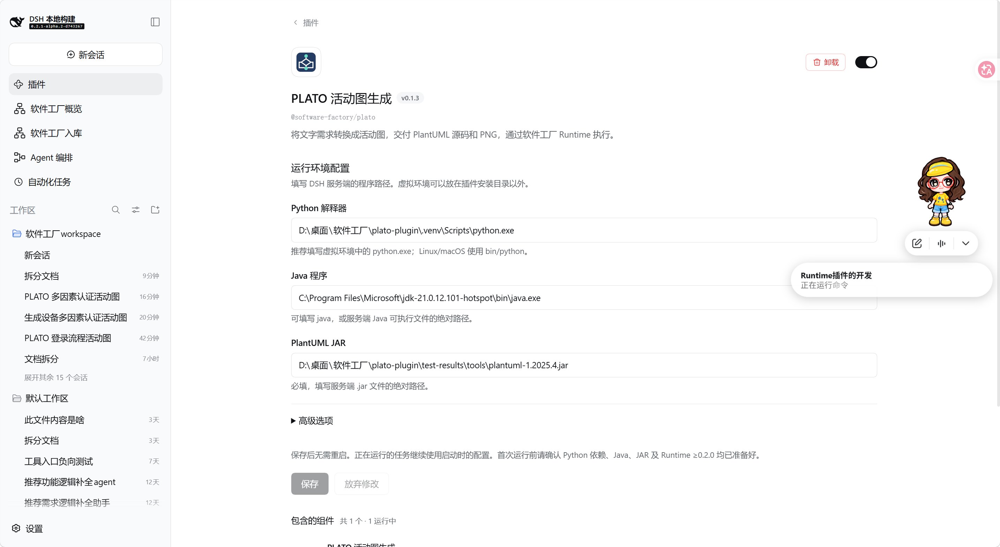
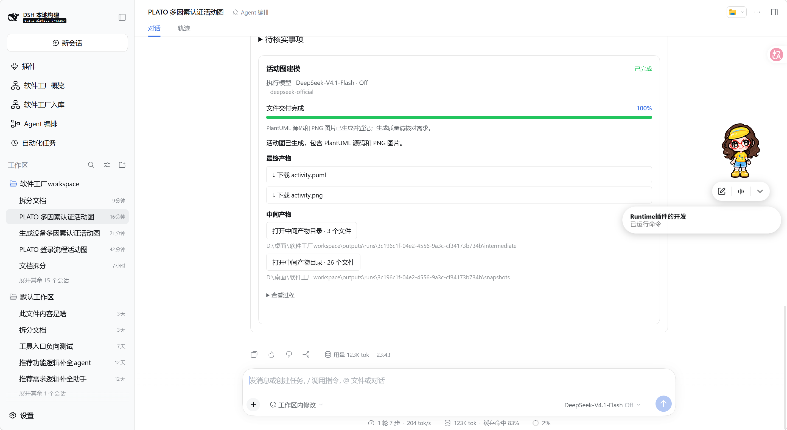

# PLATO 软件工厂 Runtime 插件

把自然语言需求转换为 UML 活动图，交付 PlantUML 源码与 PNG，并保留分析过程。实际工具 ID 为 `sf_plato_activity`。0.1.3 包含后端算法适配、DSH 插件详情页中的网页配置表单，以及按阶段估算的任务进度百分比，复用 DSH 的聊天、Runtime 与可选任务卡片；无需启动 PLATO 原有网页或 FastAPI 服务。

本次更新包含三项改进：

- 适配 Runtime SDK 0.2.0，逐次传递原算法不同阶段的 temperature，包括0温度、重试和修复调用。
- 在 DSH 插件详情页提供运行环境配置表单，可直接填写 Python、Java、PlantUML JAR 路径，保存后对后续任务生效。
- 为任务进度补上按阶段估算的百分比，成功交付显示100%，失败或取消保留当前进度。

## 1. 接入范围与限制

- 保留 PLATO 的活动识别、结构分解、信息整合、生成与修复流程及原提示词/示例。源码基线 bf36c90fa1ebebe762ebe6046006fa739c153218；复制文件清单及 SHA256 在源码包的 python/source-manifest.json 中。
- 本版本固定活动图；可选 fastcoref/CoreNLP 关闭，不等于论文完整环境。原有层数、重试与终止规则保留；达到分解上限会告警，不能据此声称需求完整。
- 模型只通过 `execution.model.call()` 调用。SDK 0.2.0 将原算法逐次给出的 temperature 从 Python 经 TS 传到 Runtime，保留 0 温度及重试调用；要求宿主 Runtime >=0.2.0。
- 模型/API 错误、空响应、无效 UML、渲染失败均失败退出，不把错误文本当正常产物。
- 当前验证范围为 Windows 和模拟模型；具体环境与网页表单测试范围见第 9 节。真实模型效果、Linux/macOS 和浏览器下载点击尚未验证。

| 原算法步骤 | temperature |
|---|---:|
| 活动识别、信息整合、PlantUML 生成和修复 | 0.2 |
| 逐层结构分解 | 0.3 |
| 指代校准、分解校验、结构框架生成和重试 | 0.0 |

粗分解提示词资源仍保留；当前活动图流程不单独调用粗分解。可选 NLP 关闭时，不执行指代校准。这里恢复的是 PLATO bf36c90 原代码的阶段温度，并非论文统一 temperature=0.75 的实验设置。具体模型/提供方需要支持温度控制；DeepSeek thinking 模式忽略 temperature，插件不自动切换模型或推理模式。

## 2. 服务端环境

| 依赖 | 要求 |
|---|---|
| DSH | 0.2.1-alpha.2；不绕过宿主版本检查安装到 rc.5 |
| Runtime | @software-factory/runtime >=0.2.0，已启用；仅升级 SDK 无法让旧 Runtime 接受温度 |
| Node.js | 24+ |
| Python | 本次验证 3.12.10，使用独立虚拟环境 |
| Python 库 | python/requirements.txt 的 httpx、PyYAML |
| Java / PlantUML | 单独准备兼容的 Java 与 PlantUML JAR；本次验证 Java 21.0.12 + PlantUML 1.2025.4 |
| DSH 原生服务 | tools、sfRuntime、subprocess；本机已有 subprocess-local |
| 网页配置表单 | DSH 原生插件管理、Settings/配置编辑器和 Client Settings 服务；这些由兼容的 DSH 网页宿主提供 |
| 模型 | DSH 中配置可用的文本模型；开发者无需获取或转交 API Key |

Python/JAR 都运行在 DSH 服务端。浏览器电脑的文件路径不能代替服务端路径。JAR 可按 [PlantUML 官方说明](https://plantuml.com/download) 获取兼容版本；不要跨电脑复制 `.venv`。

## 3. 安装与网页配置

1. 下载 `software-factory-plato-0.1.3.zip`，解压到长期保留目录。安装目录内应有 package.json、client.js、lib、python 和 cordis.patch.yml。也提供 TGZ，内容相同。
2. 在该目录准备 Python 环境（以下为 Windows 示例）：

```powershell
python -m venv .venv
.\.venv\Scripts\python.exe -m pip install -r python/requirements.txt
```

3. 在 DSH 插件管理添加这个包含 package.json 的本地目录。SDK 已随包内嵌，不用另装 SDK 服务；宿主安装器仍可能下载/解析 peer 依赖，不承诺离线安装。
4. 启用 PLATO 组合包及其 `sf-plato` 组件。安装或升级后按 DSH 提示重启后端，再刷新网页，确认插件版本为 0.1.3。
5. 打开 **DSH「插件」→「PLATO 活动图生成」详情页**。在插件名称和简介下方、**「包含的组件」上方**，可以看到 **「运行环境配置」表单**；直接在这里填写，不需要找齿轮、编辑 YAML 或修改 profile 文件。

| 网页字段 | 示例 | 说明 |
|---|---|---|
| Python 解释器 | `D:\DSH-Plugins\plato\.venv\Scripts\python.exe` | 虚拟环境中解释器的完整路径，推荐使用绝对路径 |
| Java 程序 | `java` | 可用 PATH 命令名或 Java 可执行文件绝对路径 |
| PlantUML JAR | `D:\Tools\PlantUML\plantuml.jar` | 必填，服务端 `.jar` 文件的绝对路径 |
| 高级选项 → 启动等待时间（秒） | `30` | 1～120 的整数秒数；内部对应 `startupTimeoutMs=30000` |

6. 点击 **「保存」**，看到“已保存，后续启动的任务将使用新配置”后生效。配置由 DSH 原生设置服务持久保存，重启后保留；仅修改这四个字段无需重启 DSH。**「放弃修改」**会恢复服务器当前已保存的值，不会删除已有配置。
7. 运行任务前，确保 Runtime >=0.2.0 和 subprocess 服务已启用，在真实工作区会话中配置文本模型。Runtime 未就绪、JAR 未填写时，配置页本身仍可加载；开始生成时会明确提示缺项。

路径是 **DSH 服务端**的路径，不能填写远程浏览器电脑上的路径。保存表单只校验字段格式；不会自动创建虚拟环境、安装 Python 库或下载 JAR。程序存在、依赖可导入和 JAR 可执行会在任务准备阶段检查。

用户提供的0.1.3配置页面截图如下；图中的路径是本机示例，使用时请填写实际服务端路径。



### 本机可直接填写的值

本机已在源码目录准备了虚拟环境，安装目录和环境目录可以分开。插件安装来源使用包含 package.json 的目录：

```text
D:\桌面\软件工厂\plato-plugin\dist\release-0.1.3\package
```

在上述网页表单中分别填写：

| 字段 | 本机路径/值 |
|---|---|
| Python 解释器 | `D:\桌面\软件工厂\plato-plugin\.venv\Scripts\python.exe` |
| Java 程序 | `C:\Program Files\Microsoft\jdk-21.0.12.101-hotspot\bin\java.exe` |
| PlantUML JAR | `D:\桌面\软件工厂\plato-plugin\test-results\tools\plantuml-1.2025.4.jar` |
| 启动等待时间（秒） | `30` |

保留所引用的 `.venv`、JAR 和插件安装目录；本机示例 JAR 位于 test-results，清理测试目录前请先将 JAR 放到长期目录并在网页更新路径。发布包不包含虚拟环境或 JAR，其他电脑应自行准备。

### 从 0.1.1 / 0.1.2 升级

确认没有活动任务后，通过 DSH 插件管理将同名 PLATO 包的安装来源更新为新版解压目录，按提示重启后端并刷新网页。0.1.1 没有网页配置表单，更新后应在详情页直接看到“运行环境配置”。已有的 `sf-plato` 配置会读取到表单中，后续在网页修改保存即可，无需手工迁移或改配置文件。若刚安装时组件仍为“已关闭”，启用组合包及 `sf-plato` 后再读取表单。

0.1.2 已有网页配置表单；升级到 0.1.3 后，新启动的任务还会显示进度百分比。历史任务不会补写百分比。安装目录可与原虚拟环境目录分开，网页中的 Python、Java、JAR 路径仍使用实际可用的原路径。

## 4. 实际调用

先让模型调用 `sf_runtime_get_tool_contract`：

```json
{"toolId":"sf_plato_activity"}
```

确认返回 requirement_text 后，通过 `sf_runtime_run_tool` 启动：

```json
{
  "toolId": "sf_plato_activity",
  "input": {
    "requirement_text": "Check inventory. If in stock, ship the order. Otherwise notify the customer."
  }
}
```

输入是对象；requirement_text 必须是非空字符串，不接受 diagram_type、输出目录、API Key 等额外参数。首个响应是 queued 和 runId，不是最终图片。使用 `sf_runtime_get_run` 或 `sf_runtime_wait_run` 查询，最终状态应为 completed。

模型可继承来源会话；也可在启动请求顶层指定 `model: {provider, model}`，使用 DSH 目录里的真实 ID，不放入 input。真实调用可能消耗模型额度。

不要直接调用 sf_plato_activity 绕过 Run：SDK 会拒绝缺少真实 Run 上下文的执行。

## 5. 进度、结果和取消

任务卡片同时显示阶段名称和百分比，运行时注明“估算进度”。百分比依据下面的固定阶段里程碑计算，不是模型 Token 完成比例、耗时预测、需求完整率或生成质量评分。

| 进入阶段 | 估算进度 |
|---|---:|
| 准备 PLATO 执行环境 | 0% |
| 识别活动 | 5% |
| 分析控制结构 | 20% |
| 整合信息 | 65% |
| 生成 PlantUML | 80% |
| 渲染 PNG 图片 | 95% |
| 文件交付完成 | 100% |

进度仅随实际阶段推进，任务内不倒退。结构分解、重试或 PlantUML 修复期间，可能长时间停留在同一百分比。只有 Python 正常退出、受管进程清理成功且源码与 PNG 都已登记后，才上报100%；成功终态仍由 Runtime 完成结果校验后决定。失败或取消保留最后上报的百分比，不自动补到100%。

用户提供的0.1.3运行截图展示了完成状态、100%进度、源码与PNG下载入口，以及中间产物目录。完成状态表示文件已交付，图中业务逻辑仍需对照需求核验。



```text
<workspace>/outputs/runs/<runId>/
├── input/request.json                 # Runtime 保存的输入
├── input/plato-request.json           # 算法实际输入
├── intermediate/identification.json   # 活动列表
├── intermediate/decomposition.txt    # 结构分解
├── intermediate/integration.txt      # 信息整合
├── snapshots/model-*-request.json    # 模型消息、实际请求 temperature 和原始温度记录
├── snapshots/model-*-response.json   # 回答及用量（若模型提供）
├── final/activity.puml
├── final/activity.png
└── run.json                          # Runtime 权威状态与日志
```

文件实际生成后通过 addArtifact 登记，最终返回本任务的 artifactId。使用 `sf_runtime_get_artifact` 的 `{runId,artifactId}` 获取认证下载引用；配套 WebUI 可显示下载入口。链接需要登录与工作区授权。不要把本地路径当下载 URL。

取消调用 `sf_runtime_cancel_run`，传 `{runId}`。DSH 受管进程接口停止本次 Python/Java 进程范围，清理回调等待退出；失败和取消保留已产生的材料，只完成的任务有最终结果。插件停用也会撤销入口并停止相关任务。不提供暂停或断点恢复。

此插件是可信后端：检查任务路径并使用 DSH 进程托管，但未额外施加操作系统文件沙箱；托管进程不等于任意 Python 代码的文件隔离。未提权，也未更改系统 ACL。

## 6. 开发与调试

源码含 TS 适配层、独立 Client 配置表单、Python worker、原算法副本、SDK TGZ、配置和登记资料。

安装包仅包含运行文件与正式交付资料，不包含 .d.ts、SDK 教程/示例、SDK TGZ、开发脚本或源码散列清单。SDK 执行代码保持原字节内嵌；源码包保留完整 SDK TGZ 和开发依赖资料。以下命令在源码包目录执行。

```powershell
npm.cmd ci
npm.cmd run build
npm.cmd run test:settings
npm.cmd run debug -- --python <Python解释器绝对路径> --jar <PlantUML-JAR绝对路径>
npm.cmd run pack:plugin
```

debug 使用官方 DSH Agent 测试工具，走真实 Tool → Runtime → SDK → Python → Java 链，仅模型为本地合成响应，不访问付费服务。检查正常流程、框架重试、PlantUML 修复的逐次温度，核对 Python 快照、Runtime 日志及适配器收到的参数。结果保存在 test-results/validation.json。测试专用 Runtime 0.2.0 TGZ 位于源码的 test-runtime-cache，不进入运行安装包。

src/index.ts 登记工具；src/business.ts 实现 SDK 业务入口；src/python-bridge.ts 托管进程并转发 JSONL；python/worker.py 调用原算法并保存材料。lib 是编译输出。

client.js 通过 `plugins.bundle.config` 注册详情页表单，使用 `ctx.configForms.get('sf-plato')` 的原生设置接口保存。Host Config 四个字段使用 `.volatile()`；业务入口在启动任务时读取并固定一份配置。没有新增独立配置文件、服务器保存路由或模型调用。`test:settings` 在项目 test-results 中创建独立测试 profile，检查原生 Settings 持久化与重启恢复、修改冲突、错误提示和 React 表单交互，不修改用户 profile。

`npm run prepare:python` 仅在需要同步算法副本时执行；默认读取相邻 PLATO，可通过 PLATO_SOURCE_ROOT 指定。同步会生成新的文件散列，应审阅算法差异。正常构建不依赖相邻 PLATO。

## 7. 常见错误

| 报错 | 处理 |
|---|---|
| 插件不兼容 | 核对 DSH alpha.2；不要把 peer 版本改成 rc.5 伪装兼容 |
| 详情页没有“运行环境配置” | 确认已安装 0.1.3，安装包有 client.js；按升级提示重启后端并刷新页面，检查原生 Client Settings/插件管理服务是否正常 |
| 进度显示“—” | 确认已加载0.1.3后重新启动任务；旧任务不会补写百分比。原生卡片读取Runtime的progress字段，阶段名称不能代替该字段 |
| 表单提示先启用组件 | 启用 PLATO 组合包和 sf-plato；配置页不依赖 Runtime 就绪，但需要原生 Settings 服务 |
| 无法保存或提示配置冲突 | 使用有配置写入权限的本机 DSH 网页；有冲突时先“放弃修改”读取最新值再填写，失败时草稿保留 |
| sfRuntime/subprocess 未就绪 | 启用 Runtime 和本地 subprocess 服务；核对安装 profile |
| PLATO_CONFIG_REQUIRED / 找不到解释器 | 配置服务端绝对路径，确认解释器环境已装 requirements |
| PLATO_STARTUP_TIMEOUT | 查看 Runtime 错误，确认 Python 能在本次工作区任务目录写入 |
| PLATO_MODEL_FAILED / MODEL_REQUIRED | 配置真实模型和凭据；模型返回错误不会静默换成 mock |
| 模型请求校验拒绝 temperature | 将宿主 Runtime 升至 >=0.2.0；不删除温度参数重试 |
| PLATO_INVALID_UML / PLATO_RENDER_FAILED | 检查保留的源码、模型回答、Java/JAR 兼容性 |
| 取消后未结束 | 查看清理错误；只有受管范围退出才算清理完成 |

## 8. Agent 入库资料与交付

agent-registration.json 是给平台管理员的“工具介绍表”，说明 PLATO 的名称、用途、输入输出、运行条件和实际调用名。导师可用它在能力树目录中登记 PLATO，并把目录项对应到真实工具 sf_plato_activity。它不参与生成图，也不会自动写数据库。SDK README 第 8、10 节要求提供这类资料，建议单独保存 JSON。

agent-registration.json 按 SDK 的 agent / agentVersion.properties 格式提供。agent:plato-activity 是新 Agent 的建议标识，导师入库前应确认是否已有 PLATO 身份；不覆盖已有 Agent，不伪造数据库顶点 ID。业务版本与插件包版本独立。

SDK 登记入口不会自动写能力树。平台审核后保存资料，AgentVersion.dsh_ref 必须保持 sf_plato_activity。input_schema/output_schema 和 *_json 在写 HugeGraph TEXT 前由平台逐属性序列化。开发人员按用户提供资料填写为黄益柯、林子涵、叶博一；治理启用状态、运行代价、效果和优选指标未知，均省略。性能证据分别注明论文LATO的参考指标和当前插件的合成集成测试，不能把论文成绩视为当前版本的真实模型实测成绩。

升级时保留业务 Tool 名称，先确认无活动任务，再更新安装包、按要求重启。

## 9. 验证记录

验证日期：2026-10-31。环境为 Windows、DSH 0.2.1-alpha.2、Runtime/SDK 0.1.0、Node.js 24.22.1、Python 3.12.7、Java 8 与兼容 PlantUML JAR。

使用官方 dsh-agent-loop-testkit 创建真实 Agent/Session 和工作区，通过 sf_runtime_run_tool 执行插件；未用直接调用业务函数代替正常 Run 链。以下检查已通过：

- Runtime 能发现 sf_plato_activity，取得真实输入规格；绕过 Run 直接调用会被 SDK 拒绝。
- 全空白输入在启动 Python 前失败。
- 实际运行 PLATO 的 Python 流程与 Java 渲染，生成有效的 PlantUML 和 PNG。
- 实际阶段、日志、分析材料及模型请求/回答快照可保存和查询；模型会话与主聊天隔离。
- 返回两个已登记的最终文件 ID，通过 getArtifact 取得认证下载引用。
- 模型错误使任务失败，不伪装为成功；取消时停止模型请求，并等待受管 Python 进程范围退出，保留已有材料。
- 停用插件后撤销入口。
- 精简 TGZ 在新目录安装后，完整集成检查再次通过；另通过 pnpm 安装及模块加载检查。
- 本机实际 web profile 已验证 Runtime、subprocess 服务与 PLATO 工具登记就绪。

**模型回答使用本地固定模拟数据，没有调用付费模型；Python、Java、任务管理和文件生成是真实执行。** 尚未验证真实模型效果、不同需求的语义正确性、浏览器点击下载、Linux/macOS 或论文指标。正式使用前应在目标宿主和真实模型上做一次小输入验收。

复现命令见第 6 节。本地机器可读记录为 test-results/validation.json，宿主登记检查记录为 test-results/profile-smoke.json；测试数据不进入交付包。

上述为 0.1.0 历史验证记录；0.1.1 的温度透传验证另见本节下方。原来“无法逐次指定温度”的限制已由 SDK/Runtime 0.2.0 和桥接升级解决。仍有模型/适配器自身限制，详见第 1 节。Tool 参数规格不支持 minLength/pattern，非空白要求由业务函数落实；通用 Python 通信桥由本插件实现。可选 NLP 关闭。原算法修复后仍不合法的图源码会保留并使任务失败，这是新增的交付校验。

### 0.1.1 温度透传验证（2026-11-02）

环境：Windows、DSH 0.2.1-alpha.2、SDK/Runtime 0.2.0、Node.js 24.16.0、Python 3.12.10、Java 21.0.12、PlantUML 1.2025.4。类型检查、构建及真实 Tool → Runtime → Python → Java 集成测试通过，模型为本地合成响应。

- 适配器逐次收到 `[0.2, 0.0, 0.0, 0.3, 0.0, 0.2, 0.2, 0.2]`：识别、框架生成及重试、分解、校验、整合、生成及修复。
- Python 请求快照、Runtime `requestedControls`、隔离会话 `request/header` 与适配器参数逐项一致；旧温度限制告警已移除。
- PNG/PlantUML 交付、模型错误失败、取消清理和停用撤销检查通过。原算法和提示词文件未改。
- 命令沙箱内的 Windows Job runner 首次启动超时；采用正常本地权限运行完成。另有一次 Runtime `run.json` 原子替换遇到 Windows EPERM，在新的独立 Run 目录重试后通过；未修改宿主或 ACL。

本次未安装到正在运行的 DSH profile，未调用真实模型，也未启用可选 NLP 校准。测试记录见 `test-results/validation.json`；安装时仍需确认目标宿主 Runtime >=0.2.0。

### 0.1.2 网页配置表单验证（2026-11-02）

- 类型检查、构建、Client JS 语法检查通过。
- 使用真实 Cordis Loader、Settings 和 ConfigEditor，在独立测试 profile 验证首次无路径、无 Runtime/subprocess 时仍可加载配置；原生保存和重启恢复成功，更新不会重建业务插件 fiber，已经取得的任务配置快照保持不变。
- 使用发布的 client.js 和真实 React DOM 验证字段校验、中文路径、秒到毫秒转换、保存、放弃修改、配置冲突以及传输失败提示；表单保存连接上述原生设置服务。
- 真实 Tool → Runtime → Python → Java 生成、错误、取消和温度透传回归通过，模型仍为本地合成响应。
- 未改动用户的 DSH profile 或代填配置，未安装/重启正在运行的 DSH；实际 DSH 网页中的明暗主题和浏览器控制台尚未验证。React DOM 测试不等于实际宿主视觉验收。

### 0.1.3 进度百分比验证（2026-11-02）

- 类型检查、构建以及网页配置表单的两个既有测试通过。
- 使用真实 Tool → Runtime → Python → Java 链路和本地合成模型响应，验证运行记录中的进度依次为 `[0, 5, 20, 65, 80, 95, 100]`，现有卡片可直接读取该字段。100%事件在两个最终文件登记后出现，阶段名称更新为“文件交付完成”。
- 合成响应覆盖原算法的框架重试和PlantUML修复，进度不倒退；温度透传及PNG/PUML交付回归通过。模型失败和取消场景均保留最后的5%，不报100%。
- 受限执行环境首次测试在Python启动确认处超时；在正常本地权限下重跑同一集成测试通过。未修改宿主或文件ACL。
- 原算法、提示词、Python工作流程和宿主卡片未改；未安装或重启用户的DSH，未调用真实模型。实际DSH网页的百分比显示尚未现场验证；历史任务不补写进度。

测试记录见 `test-results/validation.json`。

### 用户提供的 DSH 页面截图（2026-11-02）

第3节和第5节的原始截图由用户提供，展示本机DSH中0.1.3的配置表单和已完成任务的100%进度、产物入口。它们补充了实际页面显示证据；此前的自动化测试仍使用合成模型响应，截图不作为论文指标复现或生成语义正确率的证据。

## 10. 第三方来源

- PLATO 算法和资源来自 [Ekay47/PLATO](https://github.com/Ekay47/PLATO)，保留其 MIT 许可于 python/plato/LICENSE；本地复制清单在源码包中。
- Runtime SDK 0.2.0 由平台维护者提供。安装包保留原始 SDK 执行代码；源码包 vendor 中保留完整原包。原包未声明 license 标识，公开再发布前应向维护者确认许可。
- DSH/Cordis/Schemastery 使用宿主提供的依赖。Python、Java、PlantUML JAR 及 Python 库按各自许可单独安装；交付包不包含虚拟环境、JAR 或凭据。
